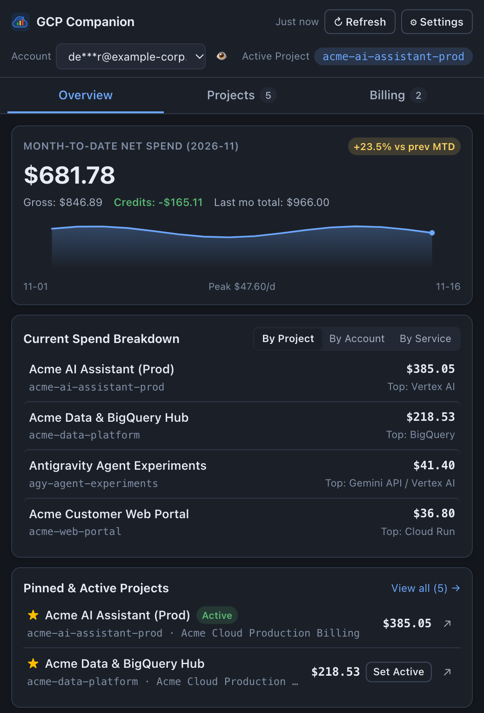

<p align="center">
  
</p>

<h1 align="center">GCP Companion for Google Antigravity</h1>

<p align="center">
  <strong>Monitor Google Cloud projects, billing accounts, budgets, and BigQuery month-to-date spend directly from the Antigravity side panel and chat agent.</strong>
</p>

<p align="center">
  <a href="./LICENSE"></a>
  
  
  
</p>

<p align="center">
  
</p>

---

## Overview

**GCP Companion (`agy-gcp-companion`)** brings real-time Google Cloud project context, Cloud Billing governance, and BigQuery FinOps spend visibility into **Google Antigravity** (App, IDE, and CLI). It synchronizes an interactive **Auxiliary Side Panel** with a local **Model Context Protocol (MCP) Server** and **Agent Skill**, sharing a unified 6-hour local cache so your UI and AI agent always see the exact same cloud state.

### Bundled Antigravity Primitives

| Primitive | Path | Capability |
| :--- | :--- | :--- |
| **Manifest** | [`plugin.json`](./plugin.json) | Declares metadata, semantic version (`1.3.0`), icon, and starter prompts. |
| **Web UI Sidecar** | [`sidecars/gcp-companion/sidecar.json`](./sidecars/gcp-companion/sidecar.json) | Interactive 3-tab Auxiliary Pane (`Overview`, `Projects`, `Billing`) mounted via `SIDECAR_UI_ENTRYPOINT_AUX_PANE`. |
| **MCP Server** | [`mcp_config.json`](./mcp_config.json) | Local `stdio` server (`dist/mcp-server.mjs`) exposing **9 tools** and **3 JSON resources**. |
| **Agent Skill** | [`skills/gcp-companion/SKILL.md`](./skills/gcp-companion/SKILL.md) | Progressive FinOps & `gcloud` context workflow (`/gcp-companion`) using interactive `ask_question` prompts. |

---

## Key Features

### 1. Interactive Auxiliary Side Panel (`GCP Companion`)
- **Sticky `gcloud` Context Header**: View and switch your active `gcloud` account (with 1-click PII email masking) and copy or switch your default `gcloud` project.
- **Overview Tab (FinOps At-a-Glance)**:
  - **Month-to-Date (MTD) Net Spend**: Net cost after credits and free-tier discounts, gross vs. credit breakdowns, and percentage delta against previous-month same-day spend.
  - **Month-End Spend Forecast & Sparkline Projection**: Zero-extra-scan end-of-month cost projections blending recent 7-day run rate (excluding partial current-day skew) with dashed projection curves on daily SVG spend sparklines.
  - **6-Month Historical Billing Archive**: Switch across recent invoice months; settled historical months automatically freeze in cache (`✓ Archived · No BQ rescan`) to eliminate redundant BigQuery scans.
  - **Flexible Breakdowns**: Toggle spend rankings **By Project**, **By Billing Account**, or **By Service**, and star (`★`) favorite projects for 1-click context switching.
- **Projects Tab**: Search active GCP projects by name, ID, number, or label; filter by `Active & Pinned`, `All`, `Pinned`, or `Unbilled`; inspect per-project top GCP services (`Vertex AI`, `Cloud Run`, `BigQuery`, etc.); **link or switch open Cloud Billing Accounts** with Before → After confirmation; or trigger **Danger Zone Project Deletion** (Web UI only, requiring exact Project ID entry with 30-day Pending Deletion recovery guidance).
- **Billing Tab**: Inspect active (open) Cloud Billing Accounts, linked active project counts, configured **Budget alert thresholds**, and connect **BigQuery Cloud Billing Export** tables via 1-click dataset auto-discovery (`Scan Datasets`) or manual `project.dataset.table` binding.
- **Progressive Instant-Shell Architecture**: Renders the UI shell immediately and loads Projects, Billing Accounts, Budgets, and BigQuery Spend independently in parallel so fast metadata never waits on BigQuery queries.
- **7-Language Internationalization (`i18n`)**: Automatic system/browser locale detection plus 1-click switching in **⚙ Settings** across **English (`en`)**, **Español (`es`)**, **Français (`fr`)**, **日本語 (`ja`)**, **한국어 (`ko`)**, **简体中文 (`zh-CN`)**, and **繁體中文 (`zh-TW`, with explicit `NT$` formatting)**.
- **Zero-Credential Demo Mode**: Click **`Preview Demo Dashboard`**, **`Preview Sample Spend`**, or **`⚙ Settings → Enable Demo Preview Mode`** to explore realistic multi-project, budget, and 6-month BigQuery spend data without connecting live cloud credentials.

### 2. Progressive Dual-Mode Cloud Design
Google Cloud's REST APIs expose projects, billing account bindings, and budget threshold definitions immediately, while exact dollar spend is delivered through **BigQuery Cloud Billing Export**:
- **Base Mode (Zero Setup)**: Works immediately once signed in with `gcloud auth login` — lists all accessible GCP projects, billing account mappings, unbilled/sandbox projects, and budget alert rules.
- **Spend Mode (BigQuery Export Linked)**: Connecting a `gcp_billing_export_v1_*` or `gcp_billing_export_resource_v1_*` table unlocks exact MTD net/gross/credit totals, month-end forecasts, 6-month archives, daily trends, and per-service cost breakdowns.

---

## Prerequisites & Cloud Permissions

- **Antigravity**: Google Antigravity App, IDE, or CLI (`agy`) — runs directly on Antigravity's bundled Node.js (`>= 18.0.0`) with **zero `npm install` step**.
- **Google Cloud CLI (`gcloud`)**: Recommended for browser sign-in (`gcloud auth login`) and local project/account switching. *(If `gcloud` is not installed yet, the panel provides guided installation links and a 1-click Demo Mode).*
- **GCP APIs & IAM Roles** *(evaluated under your existing user credentials)*:

| Mode | GCP APIs Used | Minimum Permissions / Roles |
| :--- | :--- | :--- |
| **Base Mode** *(Projects, Billing Links & Budgets)* | `cloudresourcemanager.googleapis.com`<br/>`cloudbilling.googleapis.com`<br/>`billingbudgets.googleapis.com` | • `resourcemanager.projects.get` *(e.g. Viewer / Browser)*<br/>• `billing.accounts.get`, `billing.accounts.list` *(Billing Account Viewer)*<br/>• `billing.budgets.list` *(optional, for budget thresholds)* |
| **Spend Mode** *(Optional — Exact Dollar Spend)* | `bigquery.googleapis.com` | • `bigquery.jobs.create` *(BigQuery Job User on quota/host project)*<br/>• `bigquery.tables.getData` *(BigQuery Data Viewer on the billing export dataset)* |
| **Guarded Actions** *(Optional — Switch Billing / UI Project Delete)* | `cloudbilling.googleapis.com`<br/>`cloudresourcemanager.googleapis.com` | • **Switch Project Billing**: `Project Billing Manager` on project + `Billing Account User` on target open billing account<br/>• **Delete Project (Web UI only)**: `resourcemanager.projects.delete` *(Project Deleter / Owner)* |

---

## Installation & Quickstart

Because `dist/` is pre-compiled to pure ES Modules with **zero external runtime dependencies**, no package installation or build step is required.

### Option A: Install via Antigravity CLI (`agy`)

```bash
# Install from GitHub (or directly by name once listed in Marketplace)
agy plugin install https://github.com/ericsk/agy-gcp-companion
```

### Option B: Direct Git Clone (If `agy` is not on your `PATH`)

**macOS / Linux:**
```bash
mkdir -p ~/.gemini/config/plugins
git clone https://github.com/ericsk/agy-gcp-companion.git ~/.gemini/config/plugins/agy-gcp-companion
```

**Windows (PowerShell):**
```powershell
New-Item -ItemType Directory -Force -Path "$HOME\.gemini\config\plugins" | Out-Null
git clone https://github.com/ericsk/agy-gcp-companion.git "$HOME\.gemini\config\plugins\agy-gcp-companion"
```

### First-Time Setup in Antigravity

1. **Reload Antigravity** so the newly installed plugin, MCP server, and background Web UI sidecar register.
2. *(Optional check)* Open **Customizations → Installed** in the left sidebar to verify **GCP Companion** is enabled.
3. Inside any conversation, click the **Auxiliary Side Pane (`+`)** button in the top-right corner and select **GCP Companion**.
4. **Follow Guided In-Panel Onboarding** *(or click **Preview Demo Dashboard** to test immediately without credentials)*:
   - **Not signed in?** Click **🔑 Sign in with Browser (`gcloud auth login`)** directly inside the panel.
   - **Cloud Billing API not enabled on your quota project?** Click **⚡ Enable Cloud Billing API** (free GCP API).
   - **Want exact dollar spend & forecasts?** Open the **Billing** tab → **BigQuery Billing Export Connection**, select your billing host project, and click **Scan Datasets** → **Link & Query**.

---

## Example Agent Prompts

Ask the Antigravity chat agent naturally or invoke `/gcp-companion`:

- `"Show me my current Google Cloud month-to-date spend, month-end forecast, and top spending projects"`
- `"Which GCP services are driving costs in my active project this month?"`
- `"List my unbilled or sandbox GCP projects and switch my active gcloud project"`
- `"Switch my staging project to my team's active Cloud Billing Account"`
- `"Check if I have any BigQuery billing export tables in my billing admin project and connect them"`
- `"/gcp-companion"` *(launches an interactive menu to inspect status, compare spend, or switch context)*

---

## MCP Server Reference (`gcp-companion`)

### Tools (9)

| Tool Name | Mode | Description |
| :--- | :---: | :--- |
| `gcp_companion_status` | Read-Only | Returns local `gcloud` auth state, active account/project, pinned projects, BigQuery export bindings, and cache freshness. |
| `gcp_list_projects` | Read-Only | Lists active GCP projects enriched with active billing account status, pin flag, and MTD net spend; supports `query`, `billingAccountId`, `pinnedOnly`, and `unbilledOnly` filters. |
| `gcp_list_billing_accounts` | Read-Only | Lists active (open) Cloud Billing Accounts, linked active project counts, budget alert rules, and MTD net/gross/credit totals. |
| `gcp_get_billing_summary` | Read-Only | Returns MTD net spend, gross cost, credits, previous-month same-day comparison, month-end forecast, daily spend series, and top projects. |
| `gcp_get_project_cost_breakdown` | Read-Only | Returns per-service cost breakdown (`Vertex AI`, `Cloud Run`, `BigQuery`, etc.), daily trend, credits, and Console deep links for a `projectId`. |
| `gcp_set_active_project` | Local Config | Runs validated `gcloud config set project <projectId>` (and optionally pins the project), syncing immediately with the side panel. |
| `gcp_set_active_account` | Local Config | Switches the active local `gcloud` account among accounts already authenticated on the workstation. |
| `gcp_set_project_billing_account` | Guarded Cloud | Links or switches a project to an open Cloud Billing Account (`PUT .../billingInfo`) via a mandatory two-step `confirm: true` preview-then-apply gate (unlinking billing is blocked). |
| `gcp_configure_billing_export` | Local Config | Auto-discovers `gcp_billing_export_*` tables in a `hostProjectId` (`discoverOnly: true`) or binds/unlinks a `project.dataset.table` reference. |

### Resources (3)

| Resource URI | MIME Type | Summary |
| :--- | :--- | :--- |
| `gcp-companion://overview` | `application/json` | Active `gcloud` context (respecting PII email masking), project/account counts, cache age, and MTD spend totals by currency. |
| `gcp-companion://projects` | `application/json` | Enriched list of GCP projects with billing bindings and current-month net spend. |
| `gcp-companion://billing` | `application/json` | Cloud Billing accounts, budget threshold definitions, and BigQuery spend breakdowns. |

---

## Architecture, Privacy & Security Posture

GCP Companion is engineered with defense-in-depth guardrails for local agentic environments:

- **Zero Stored Credentials or Secrets**: Authenticates exclusively through the user's existing local `gcloud` CLI / Application Default Credentials (ADC). The plugin never collects, logs, or writes OAuth client secrets, raw access/refresh tokens, or API keys to disk.
- **Guarded Cloud Governance & Blast-Radius Controls**:
  - All discovery and spend queries (`cloudresourcemanager`, `cloudbilling`, `billingbudgets`, `bigquery`) are read-only by default, automatically filtering out closed billing accounts and pending-deletion projects.
  - Switching a project's billing account is restricted strictly to **open** Cloud Billing Accounts with explicit Before → After confirmation in the UI and a mandatory two-step `confirm: true` gate in MCP; **unlinking/disabling billing and modifying budget rules remain strictly blocked** to prevent accidental production outages.
  - **Project Deletion** (`DELETE /v3/projects/{projectId}`) is **isolated exclusively to the Web UI** (never exposed as an MCP tool to AI agents) and requires typing the exact `projectId` inside a Danger Zone drawer with impact warnings and 30-day GCP Pending Deletion recovery links.
- **Command & SQL Injection Prevention**:
  - Subprocess invocations (`gcloud`, `agy`, `git`) execute strictly via `execFile` with `shell: false` and regex allowlist validation on project IDs, account emails, billing IDs, and table identifiers (blocking `--flag` injection).
  - BigQuery spend queries use parameterized query arguments (`@minInvoiceMonth`, etc.), strict identifier validation, and `_PARTITIONTIME` partition pruning bounded to active billing windows.
- **Loopback-Only Web UI Sidecar & CSRF Hardening**:
  - Binds exclusively to `127.0.0.1` (never `0.0.0.0`).
  - Serves hardened HTTP headers (`Content-Security-Policy: default-src 'self' ...; script-src 'self'; style-src 'self'; object-src 'none'`, `X-Content-Type-Options: nosniff`, `Cache-Control: no-store`).
  - Zero `innerHTML`, `outerHTML`, `eval`, or inline styles — every DOM node and SVG chart is constructed via `document.createElement` / `createElementNS` and `textContent` (enforced by automated static AST/regex tests).
  - Protects all state-changing `POST` endpoints with `Origin` allowlisting, preflight-gated `X-AGY-Companion: 1` header checks, HMAC-signed session CSRF tokens (`HttpOnly; SameSite=Strict`), and per-minute rate limiting.
- **Local Cache Privacy & PII Masking**:
  - Snapshots and preferences are stored locally under `~/.gemini/agy-gcp-companion/` (`0700` directory mode, `0600` file permissions), isolated per SHA-256 hashed account key.
  - 1-click PII email masking (`e***@domain.com`) redacts account emails across both the Side Panel UI and MCP tool/resource outputs.
- **Zero Supply-Chain Footprint & Transparent Updates**:
  - Ships with **zero `dependencies` or `devDependencies`** in `package.json`, running entirely on Node.js built-in modules.
  - Periodic update checks read `plugin.json` from GitHub over HTTPS without sending any user or telemetry data, skip symlinked developer directories, and can be disabled anytime in **⚙ Settings**.

---

## Troubleshooting & FAQ

<details>
<summary><strong>Why does Overview show "Unlock Month-to-Date Spend Tracking" instead of dollar amounts?</strong></summary>

Google Cloud's Cloud Billing REST API exposes billing accounts, project links, and budget rules, but does not expose real-time dollar spend. To view exact MTD net spend, credits, forecasts, and per-service costs:
1. Enable **Standard usage cost** export to BigQuery in [GCP Console → Billing → Billing export](https://console.cloud.google.com/billing).
2. In GCP Companion, open **Billing → BigQuery Billing Export Connection**, pick your host project, and click **Scan Datasets** → **Link & Query**.
*(Tip: Click **Preview Sample Spend** on the Overview tab to test all spend charts immediately with sample data.)*
</details>

<details>
<summary><strong>Why am I prompted to enable the Cloud Billing API?</strong></summary>

Google Cloud requires `cloudbilling.googleapis.com` (a free API) to be enabled on your active quota project (`x-goog-user-project`) when calling Cloud Billing REST endpoints with user credentials. Click **⚡ Enable Cloud Billing API** inside the panel (or set a custom Quota Project Override under **⚙ Settings → Advanced CLI & Quota Settings**).
</details>

<details>
<summary><strong>How often does GCP Companion query BigQuery?</strong></summary>

By default, results are cached locally for **6 hours** (configurable from 1 hour to 7 days in **⚙ Settings**), and settled historical months are archived permanently so they are never rescanned unless you click **↻ Refresh** (`forceRefresh: true`).
</details>

---

## Local Development & Validation

```bash
# 1. Compile TypeScript (Node built-in type stripping) & run all 47 security/unit/UI tests
npm test

# 2. Validate plugin manifest, MCP config, sidecar, and skill strictly via Antigravity CLI
agy plugin validate --strict

# 3. Symlink into ~/.gemini/config/plugins/agy-gcp-companion for live local testing
npm run install:global

# 4. Run standalone local sidecar preview in browser (http://127.0.0.1:8787)
npm run dev:sidecar
```

---

## Changelog & License

- Release history: [CHANGELOG.md](./CHANGELOG.md)
- Licensed under the [Apache License 2.0](./LICENSE).
